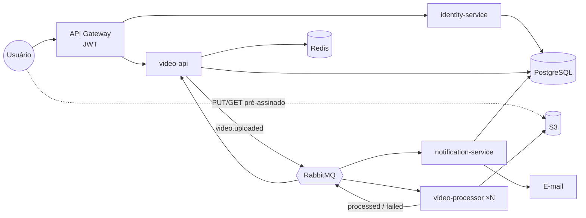

# FIAP X — Plataforma de processamento de vídeos

Hackathon da Fase 5 da POS Tech FIAP (Software Architecture). Usuários autenticados enviam vídeos, a plataforma extrai
1 frame por segundo e disponibiliza um `.zip` com as imagens, de forma **assíncrona, escalável e sem perder requisições**.

Este repositório é o **hub da plataforma**: arquitetura, decisões (ADRs), contratos de mensagem, scripts de banco
e o ambiente local completo. O código de cada serviço fica no repositório dele.

## Repositórios

| Repositório | Responsabilidade | Stack |
|---|---|---|
| **`fiapx`** (este) | Arquitetura, ADRs, contratos, docker-compose da plataforma, E2E | Markdown, Mermaid, AsyncAPI |
| [`fiapx-identity-service`](https://github.com/FiapXHacka/fiapx-identity-service) | Cadastro, login, JWT RS256 / JWKS | .NET 10 |
| [`fiapx-video-api`](https://github.com/FiapXHacka/fiapx-video-api) | Ciclo de vida do vídeo, URLs pré-assinadas, status | .NET 10 |
| [`fiapx-video-processor`](https://github.com/FiapXHacka/fiapx-video-processor) | Extração de frames (ffmpeg) e zip | Go |
| [`fiapx-notification-service`](https://github.com/FiapXHacka/fiapx-notification-service) | E-mail em falha/sucesso | .NET 10 |
| [`fiapx-infra-k8s`](https://github.com/FiapXHacka/fiapx-infra-k8s) | VPC, EKS, ECR, API Gateway, RabbitMQ, Redis, KEDA, observabilidade | Terraform, Helm |
| [`fiapx-infra-db`](https://github.com/FiapXHacka/fiapx-infra-db) | RDS PostgreSQL, S3 | Terraform |

## Visão geral

## Documentação

| Documento | Conteúdo |
|---|---|
| [1. Contexto e requisitos](docs/architecture/01-contexto-e-requisitos.md) | Diagnóstico do protótipo, RF/RNF e como cada um é atendido |
| [2. System design](docs/architecture/02-system-design.md) | C4 (contexto, containers, componentes), implantação AWS, capacidade, modos de falha, segurança |
| [3. Fluxos](docs/architecture/03-fluxos.md) | Sequências: cadastro/login, upload, processamento, falha/DLQ, status/download, reconciliação, pico |
| [4. Mensageria](docs/architecture/04-mensageria.md) | Topologia RabbitMQ, catálogo de eventos, regras de consumo |
| [5. Dados](docs/architecture/05-dados.md) | Máquina de estados, modelo relacional, S3, Redis |
| [ADRs](docs/adr/README.md) | 18 decisões de arquitetura |
| [Contratos (AsyncAPI)](docs/contracts/asyncapi.yaml) | Fonte da verdade dos eventos |
| [Scripts de banco](docs/database/) | Criação dos bancos, usuários e tabelas |
| [SonarCloud](docs/sonarcloud.md) | Configuração da análise e quality gate |

## Como o time trabalha

- Backlog no [GitHub Project da organização](https://github.com/orgs/FiapXHacka/projects). As issues ficam no repositório onde o código muda.
- Branch `feat/<nº-issue>-descricao` → PR com `Closes FiapXHacka/<repo>#<nº>` → 1 aprovação + CI + quality gate.
- Decisão nova ou alterada → ADR em PR neste repositório ([como escrever](docs/adr/README.md)).

## Entregáveis do hackathon

- [ ] Documentação da arquitetura (este repositório)
- [ ] Scripts de criação do banco e dos demais recursos (`docs/database/`, `fiapx-infra-*`)
- [ ] Links dos repositórios no GitHub
- [ ] Vídeo de até 10 minutos: documentação, arquitetura e projeto funcionando
