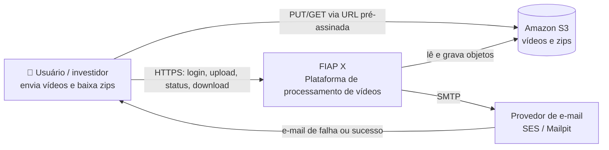
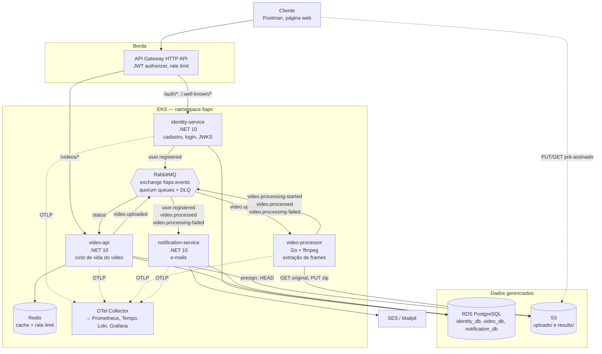
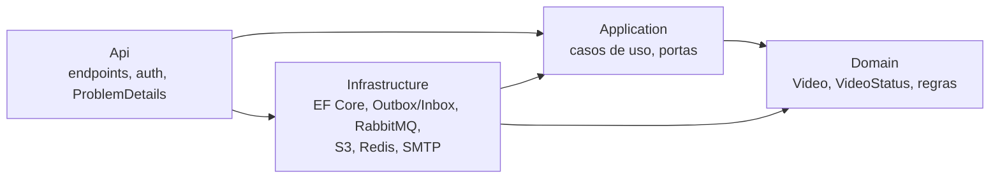
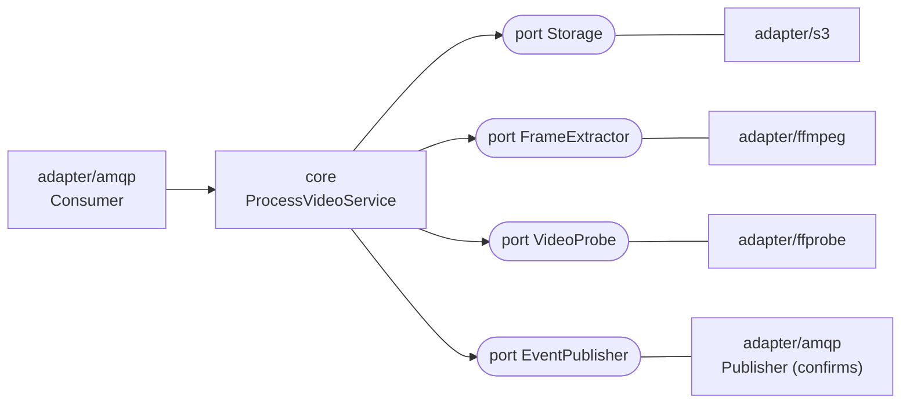
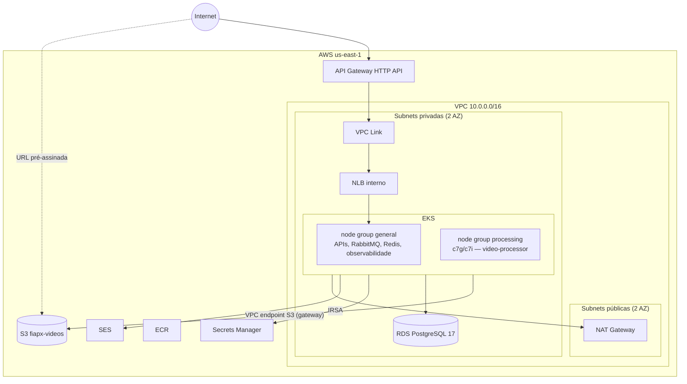

# 2. System design

## 2.1 Contexto (C4 — nível 1)

## 2.2 Containers (C4 — nível 2)

| Container | Responsabilidade | Escala | Estado |
|---|---|---|---|
| `identity-service` | Usuários, senhas e emissão de tokens | HPA 2–6 | `identity_db` |
| `video-api` | Dono do agregado Vídeo e da máquina de estados; URLs pré-assinadas; listagem | HPA 2–6 | `video_db` + Redis |
| `video-processor` | Extração de frames e zip (CPU-bound) | KEDA 1–10 pela fila | nenhum (S3) |
| `notification-service` | Projeção de contatos e envio de e-mail | 2 fixas | `notification_db` |

## 2.3 Componentes internos

### Serviços .NET (Clean Architecture)

### video-processor (hexagonal)

## 2.4 Implantação (AWS)

- Pods acessam o S3 pelo **VPC Gateway Endpoint**, o que evita tráfego de vídeo pelo NAT (custo).
- Nenhum Service do cluster é público. A única entrada é o API Gateway ([ADR-0013](../adr/0013-infraestrutura-aws-eks-compose.md)).

## 2.5 Ambiente local (docker-compose no repositório `fiapx`)

| Serviço | Imagem | Porta no host |
|---|---|---|
| identity-service | build de `../fiapx-identity-service` (profile `apps`) | 8091 |
| video-api | build de `../fiapx-video-api` (profile `apps`) | 8092 |
| notification-service | build de `../fiapx-notification-service` (profile `apps`) | 8093 |
| video-processor | build de `../fiapx-video-processor` (profile `apps`) | — |
| postgres | `postgres:17.12-alpine` (o init cria os 3 bancos, os usuários e as tabelas) | 15432 |
| rabbitmq | `rabbitmq:4.2.9-management` (topologia via `definitions.json`) | 5672 / 15672 |
| redis | `redis:7.4.12-alpine` | 6379 |
| s3 | `rustfs/rustfs:1.0.6`, compatível com S3 (a MinIO deixou de publicar imagens comunitárias) + job `s3-init` (`amazon/aws-cli`) | 9000 / 9001 |
| mailpit | `axllent/mailpit:v1.34.0` | 1025 / 8025 |
| otel-lgtm | `grafana/otel-lgtm:0.41.1` | 3000 / 4317 / 4318 |
| gateway | `traefik:v3.7.19` (roteia `/auth`, `/.well-known` e `/videos`) | 8080 / 8088 |

Como subir: seção *Ambiente local* do [README](../../README.md).

## 2.6 Estimativa de capacidade

Premissas, para dimensionamento e para a demo, sem medição real:

| Premissa | Valor |
|---|---|
| Vídeo médio | 3 min, 1080p, ~60 MB |
| Frames por vídeo médio | 180 PNG × ~2,5 MB ≈ 450 MB de frames, zip ≈ 430 MB (PNG quase não comprime) |
| Tempo de processamento (1 vCPU) | ~30–60 s por vídeo médio (decodificação + PNG + upload) |
| Pico de referência | 100 uploads em 1 minuto |

Cálculos:
- 1 pod com 2 slots ≈ **2–4 vídeos/min**. 10 pods ≈ **20–40 vídeos/min**, então o pico de 100 drena em ~3–5 min.
  A fila absorve o pico e nada é recusado. O pico aparece como latência, não como erro.
- Disco temporário por slot: até ~1,5 GB (vídeo de 10 min, o limite). Por isso o pod pede 4 Gi de `ephemeral-storage`, com limite de 8 Gi.
- S3 com 1.000 vídeos/dia: ~0,5 TB/dia de zips. O lifecycle de 30 dias é obrigatório para o custo não crescer sem limite.
- API: as requisições não carregam bytes de vídeo, então 2 pods pequenos atendem centenas de req/s. O gargalo é o worker, por design.

## 2.7 Modos de falha

| Falha | Efeito | Comportamento do sistema |
|---|---|---|
| Worker morre no meio do vídeo | Mensagem sem ack | RabbitMQ reentrega a outro worker; o resultado é idempotente pela chave determinística |
| Vídeo corrompido | `ffprobe` falha | `INVALID_VIDEO`, sem retry, e-mail ao usuário |
| Vídeo que derruba o worker sempre (OOM) | Reentregas | `x-delivery-limit=3` → DLQ → `MAX_ATTEMPTS_EXCEEDED` → e-mail |
| RabbitMQ indisponível | APIs não conseguem publicar | Outbox acumula no Postgres e publica quando o broker volta; a API continua aceitando |
| Postgres indisponível | APIs retornam `503` | Health check `/health/ready` tira o pod do balanceamento; sem perda (o cliente repete) |
| Redis indisponível | Sem cache/rate limit | Leitura direta do banco; rate limit falha aberto |
| SMTP indisponível | E-mail não sai | Retry com backoff; a notificação fica `FAILED` e vai para a DLQ; o status na listagem continua correto |
| Cliente não confirma o upload | Vídeo em `PENDING_UPLOAD` | Reconciliador marca `EXPIRED` após 1 h; lifecycle remove o objeto |
| Evento duplicado ou fora de ordem | — | Inbox + máquina de estados monotônica ignoram |

## 2.8 Segurança

- **Autenticação:** JWT RS256 de 60 min; o gateway e cada serviço validam assinatura, `iss`, `aud` e `exp`.
- **Autorização:** `user_id = sub` em toda query; recurso de outro usuário responde `404`.
- **Dados em repouso:** RDS e S3 cifrados (SSE). **Em trânsito:** TLS no gateway, no RDS e no S3.
- **Segredos:** Secrets Manager montado via CSI/IRSA; nada em variável no repositório.
- **Supply chain:** imagens distroless/alpine com usuário não-root, Trivy no CI, Dependabot em cada repositório.
- **Entrada:** validação de extensão, tamanho e conteúdo (`ffprobe`). O ffmpeg roda com timeout e sem shell (`exec` com argumentos, sem interpolar nome de arquivo do usuário).
