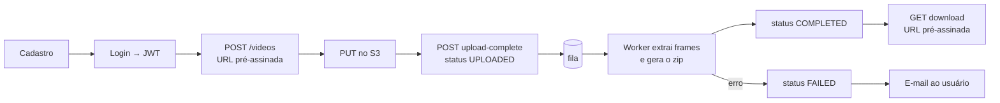
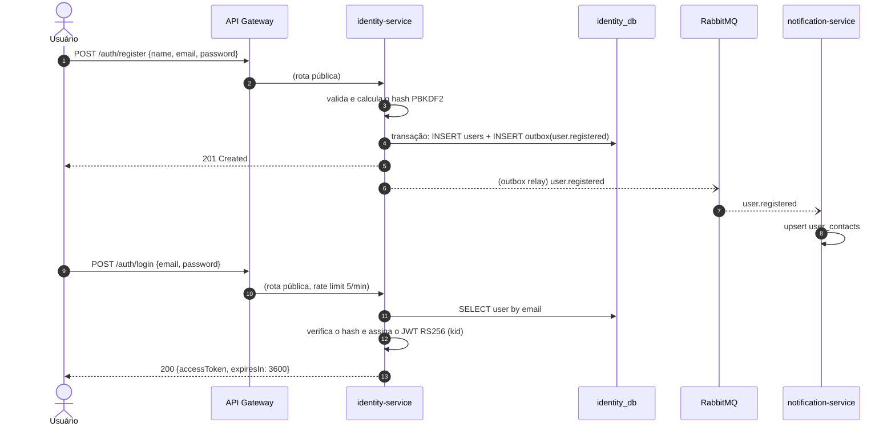
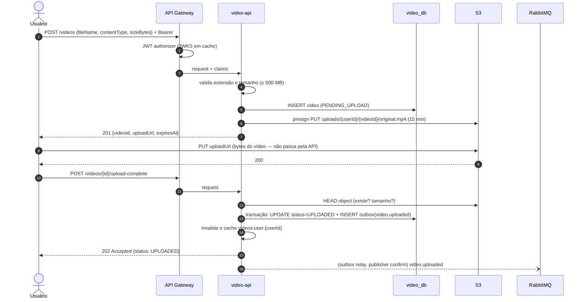
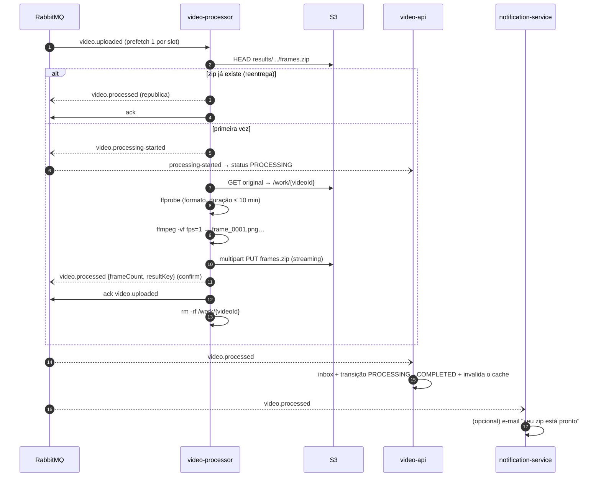
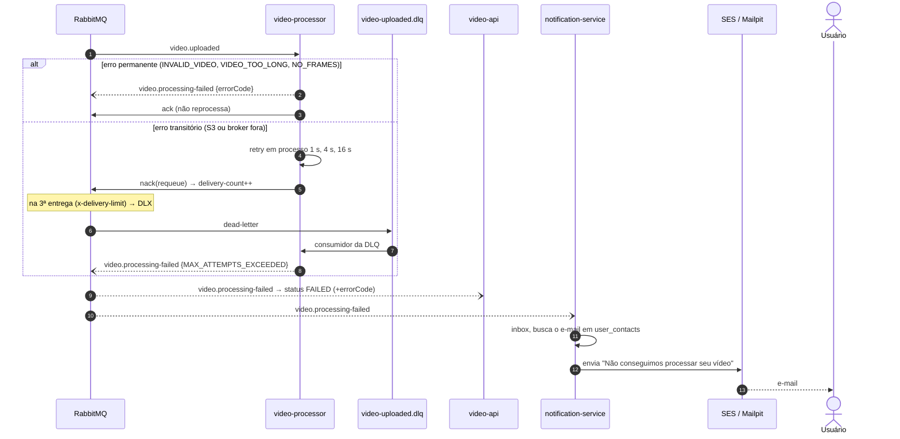
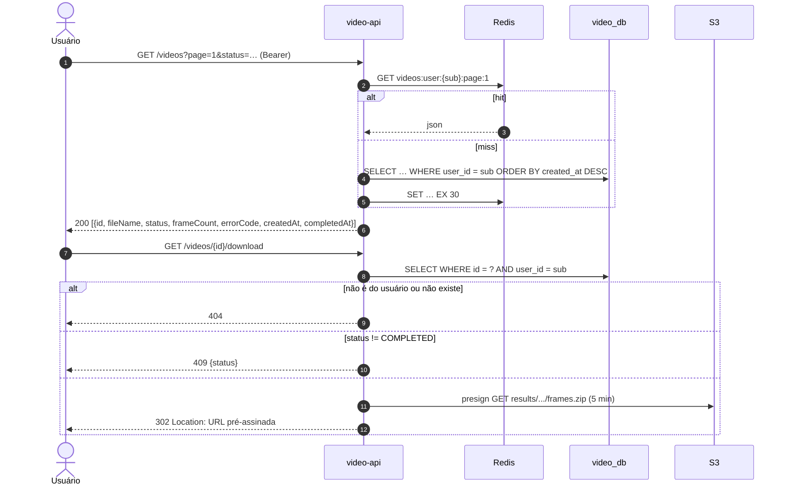
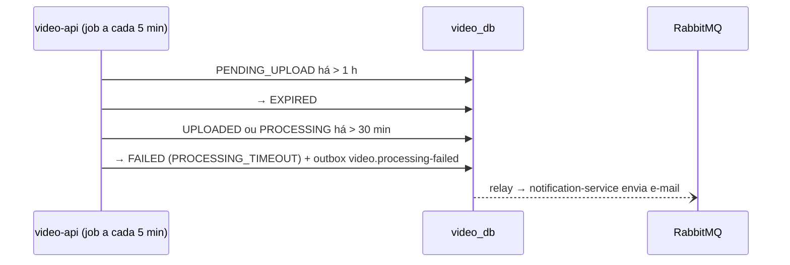
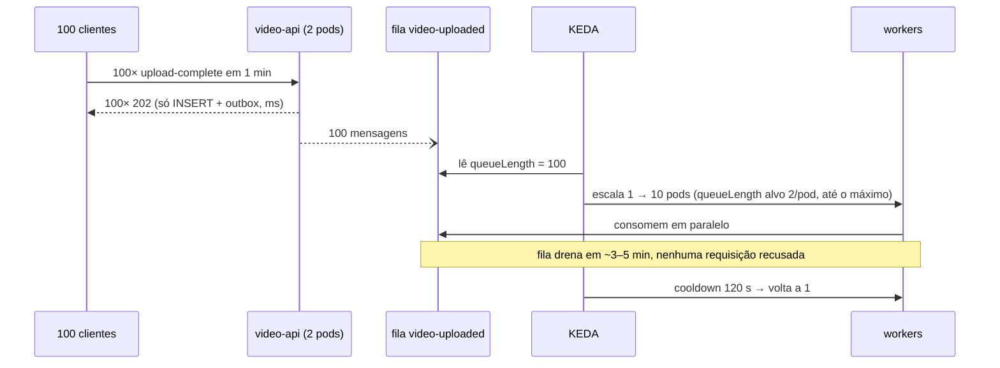

# 3. Fluxos

## 3.1 Visão geral (fluxo feliz)

## 3.2 Cadastro e login

## 3.3 Upload do vídeo

## 3.4 Processamento — sucesso

## 3.5 Processamento — falha, retry e DLQ

## 3.6 Listagem de status e download

## 3.7 Reconciliação (rede de segurança)

## 3.8 Pico de requisições

