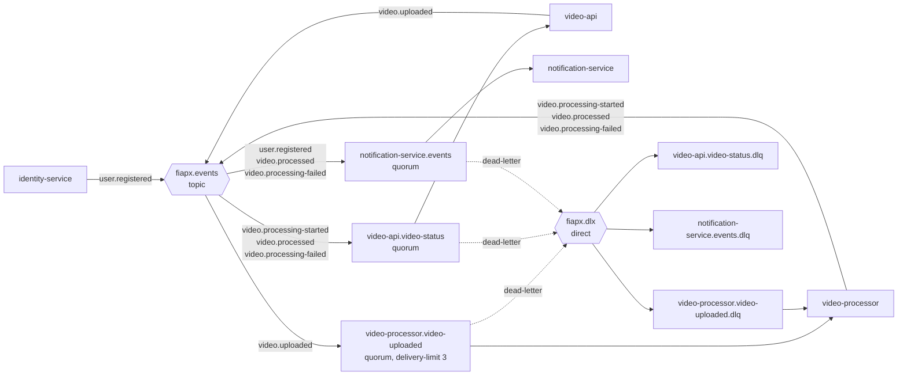

# 4. Mensageria

Decisões: [ADR-0005](../adr/0005-processamento-assincrono-rabbitmq.md), [ADR-0006](../adr/0006-contratos-de-mensagem-cloudevents.md), [ADR-0007](../adr/0007-entrega-confiavel-outbox-inbox.md).
Contrato formal: [`../contracts/asyncapi.yaml`](../contracts/asyncapi.yaml).

## 4.1 Topologia



### Declaração

| Objeto | Tipo / argumentos | Quem declara |
|---|---|---|
| `fiapx.events` | exchange `topic`, durável | todos (idempotente) |
| `fiapx.dlx` | exchange `direct`, durável | todos |
| `video-processor.video-uploaded` | `x-queue-type=quorum`, `x-delivery-limit=3`, `x-dead-letter-exchange=fiapx.dlx`, `x-dead-letter-routing-key=video-processor.video-uploaded.dlq`, `x-consumer-timeout=2400000` (40 min) | video-processor |
| `video-api.video-status` | quorum, `x-delivery-limit=5`, DLX | video-api |
| `notification-service.events` | quorum, `x-delivery-limit=5`, DLX | notification-service |
| `*.dlq` | quorum, sem consumidor automático (exceto a DLQ do worker) | dono da fila principal |

No EKS, usuários do RabbitMQ por serviço com permissão de *write* só no `fiapx.events` e de *read* só nas próprias filas
(mesmo modelo de usuários com escopo por serviço da fase 4).

## 4.2 Catálogo de eventos

Todos seguem o envelope CloudEvents 1.0 (`id`, `source`, `type`, `time`, `subject`, `dataschema`, `traceparent`, `data`).

| `type` (routing key) | Produtor | Consumidores | `data` |
|---|---|---|---|
| `user.registered` | identity-service | notification-service | `userId`, `email`, `name` |
| `video.uploaded` | video-api | video-processor | `videoId`, `userId`, `fileName`, `contentType`, `sizeBytes`, `storage {bucket, key}`, `options {fps}` |
| `video.processing-started` | video-processor | video-api | `videoId`, `userId`, `attempt`, `startedAt` |
| `video.processed` | video-processor | video-api, notification-service | `videoId`, `userId`, `frameCount`, `durationSeconds`, `result {bucket, key, sizeBytes}`, `processingMs` |
| `video.processing-failed` | video-processor, video-api (reconciliador) | video-api, notification-service | `videoId`, `userId`, `errorCode`, `errorMessage` (seguro para exibir), `attempt` |

### Exemplo — `video.uploaded`

```json
{
  "specversion": "1.0",
  "id": "01936f5e-8a4b-7c3d-9e2f-1a2b3c4d5e6f",
  "source": "fiapx/video-api",
  "type": "video.uploaded",
  "time": "2026-11-23T18:04:05Z",
  "subject": "01936f5e-7f00-7aaa-8bbb-ccccdddd0001",
  "dataschema": "fiapx/video.uploaded/v1",
  "datacontenttype": "application/json",
  "traceparent": "00-4bf92f3577b34da6a3ce929d0e0e4736-00f067aa0ba902b7-01",
  "data": {
    "videoId": "01936f5e-7f00-7aaa-8bbb-ccccdddd0001",
    "userId": "01936f50-0000-7000-8000-000000000042",
    "fileName": "pitch-investidores.mp4",
    "contentType": "video/mp4",
    "sizeBytes": 62914560,
    "storage": { "bucket": "fiapx-videos-dev", "key": "uploads/01936f50-…/01936f5e-…/original.mp4" },
    "options": { "fps": 1 }
  }
}
```

## 4.3 Regras para consumidores

1. **Ack manual**, só depois que o efeito estiver persistido (banco, S3 ou evento confirmado).
2. **Idempotência** pelo `id` do CloudEvent (inbox nos serviços .NET; chave determinística no worker).
3. Ignorar campos desconhecidos (*tolerant reader*); falhar só em campos obrigatórios ausentes, mandando a mensagem para a DLQ com log.
4. Propagar o `traceparent` para os eventos derivados.
5. Mensagem sem `id` ou com `type` desconhecido → ack + log `warn` (não envenena a fila).
