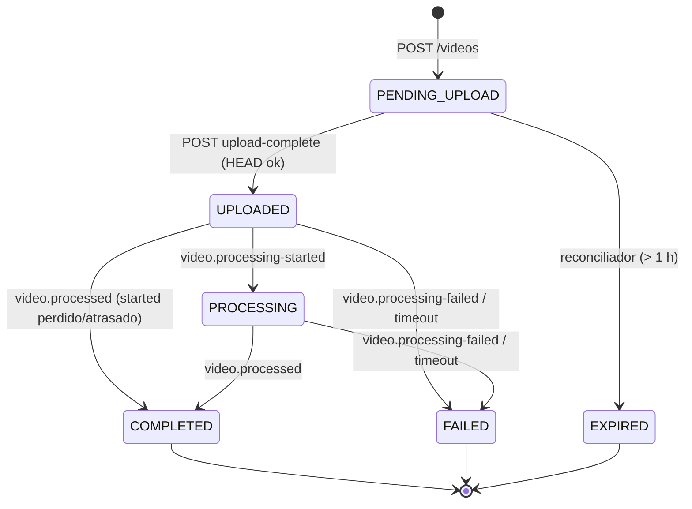
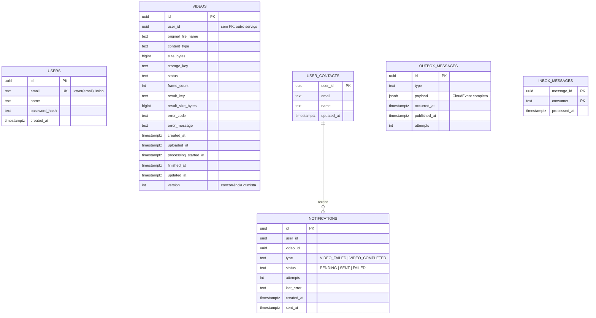

# 5. Dados

Decisões: [ADR-0009](../adr/0009-postgresql-banco-por-servico.md), [ADR-0008](../adr/0008-armazenamento-s3-presigned-urls.md), [ADR-0010](../adr/0010-redis-cache-e-rate-limit.md).
Os scripts oficiais ficam em `db/schema.sql` de cada serviço e são aplicados pelas migrations do EF Core. O script
que cria bancos e usuários fica no `fiapx-infra-db`. A versão de referência completa está em [`../database/`](../database/).

## 5.1 Máquina de estados do vídeo

Regras:
- Transições não listadas são **ignoradas** (log `info`), nunca lançam erro ao consumidor. É isso que garante a idempotência e a tolerância a eventos fora de ordem.
- `COMPLETED`, `FAILED` e `EXPIRED` são terminais. Reprocessar é uma evolução (um novo vídeo com o mesmo arquivo).

## 5.2 Modelo relacional

| Banco | Tabelas | Dono |
|---|---|---|
| `identity_db` | `users`, `outbox_messages` | identity-service |
| `video_db` | `videos`, `outbox_messages`, `inbox_messages` | video-api |
| `notification_db` | `user_contacts`, `notifications`, `inbox_messages` | notification-service |

## 5.3 Armazenamento de objetos

| Prefixo | Conteúdo | Escrito por | Lido por | Lifecycle |
|---|---|---|---|---|
| `uploads/{userId}/{videoId}/original.{ext}` | Vídeo enviado | cliente (URL pré-assinada) | video-processor | 7 dias |
| `results/{userId}/{videoId}/frames.zip` | Zip dos frames | video-processor | cliente (URL pré-assinada) | 30 dias |

Uploads multipart incompletos são abortados após 1 dia (regra de lifecycle).

## 5.4 Redis

| Chave | Valor | TTL | Invalidação |
|---|---|---|---|
| `videos:user:{userId}:page:{n}:{statusFilter}` | JSON da página | 30 s | mudança de status de qualquer vídeo do usuário |
| `videos:user:{userId}:keys` | set com as chaves acima | 30 s | junto com as chaves |
| `rl:login:{ip}:{emailHash}` | contador | 60 s | — |
| `rl:videos:{userId}` | contador | 60 s | — |
